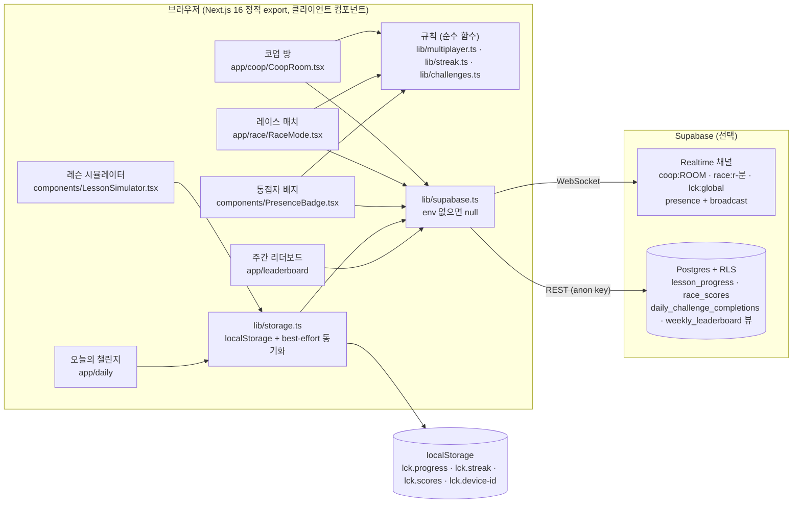

# learn-codex-kr

> OpenAI Codex CLI를 설치·가입 없이 브라우저에서 한국어로 연습하는 학습 사이트. 레슨 5개, 오늘의 챌린지, 2인 코업·레이스 모드.

라이브: <https://learn-codex-kr.vercel.app> (Vercel, 루트 경로) · <https://cskwork.github.io/learn-codex-kr/> (GitHub Pages, `/learn-codex-kr` 서브패스)

> **현재 배포 상태 (2026-10-28 확인):** 두 라이브 빌드 모두 Supabase 환경 변수 없이 빌드되어 있어
> 실시간 코업·레이스·동접자 표시는 꺼져 있고, 같은 문제를 혼자 푸는 오프라인 모드로 동작합니다.
> 실시간 기능을 켜는 절차는 [`LAUNCH.md`](LAUNCH.md) 1번 섹션에 있습니다.

## 어떤 문제를 푸나

Codex CLI의 `/goal`, `/plan`, `/verify` 같은 슬래시 명령은 영어 문서와 실제 설치 환경이 있어야 익힐 수 있습니다.
이 사이트는 명령을 직접 입력하면 즉시 정답·힌트를 돌려주는 시뮬레이터로 그 진입 장벽을 없앱니다.
서버 없이 정적 파일로만 배포되고, 진행도는 기기(localStorage)에 남습니다. Supabase를 연결하면 같은 코드가
실시간 코업·레이스와 주간 리더보드로 확장됩니다.

## 아키텍처



자세한 구성·데이터 흐름·실패 처리: [`docs/architecture.md`](docs/architecture.md)

## 핵심 기술 결정

- **서버 없는 정적 export.** API 라우트·미들웨어·서버 액션이 없고 모든 동적 동작은 브라우저의 Supabase anon 클라이언트가 처리합니다 (`next.config.ts`의 `output: "export"`). → [ADR 0001](docs/adr/0001-static-export-with-optional-supabase.md)
- **Supabase가 없어도 전부 동작.** `getSupabase()`가 env 없을 때 `null`을 돌려주고, 코업·레이스는 `SoloCoop`·`SoloRace`로, 리더보드는 로컬 기록으로 내려갑니다 (`src/lib/supabase.ts`, `src/app/coop/CoopRoom.tsx`, `src/app/race/RaceMode.tsx`).
- **실시간 상태는 서버 없이 presence + broadcast로만 동기화.** presence 키를 device id로 써서 한 기기의 여러 탭을 한 명으로 셉니다. 레이스는 1분 슬롯 id(`r-<분>`)와 그 id의 해시로 모든 클라이언트가 같은 매치·같은 문제를 계산합니다 (`src/lib/multiplayer.ts`). → [ADR 0002](docs/adr/0002-realtime-presence-broadcast-no-server.md)
- **회원가입 없는 device-id 정체성.** `lck.device-id`를 localStorage에 만들고 동물 이름 + id 끝 3자리로 표시명을 정합니다 (`src/lib/device-id.ts`). DB 쓰기의 신원도 이 값이라 위변조 방어는 없습니다(아래 한계).
- **스트릭은 KST 자정 기준.** UTC로 세던 버그를 고친 순수 함수 `kstDay`·`advanceStreak` (`src/lib/streak.ts`, 커밋 `fead66e`).
- **한 빌드로 두 배포.** Vercel(`VERCEL` env)에서는 루트, 그 외 production 빌드는 `/learn-codex-kr` basePath (`next.config.ts`, 커밋 `b6355d9`).

## 로컬 실행

Node 22.18+ (`node --test`가 `.ts`를 바로 실행), pnpm 10.

```bash
pnpm install --frozen-lockfile
cp .env.local.example .env.local   # 선택: Supabase URL/anon key. 비우면 오프라인 모드
pnpm dev        # http://localhost:3000
pnpm lint
pnpm test       # node --test src/lib/*.test.ts
pnpm build      # 정적 export → out/
```

> pnpm 11은 `pnpm-workspace.yaml`의 빌드 스크립트 설정을 다르게 읽어 설치가 실패하고 파일을 고쳐 씁니다. CI·배포와 같은 pnpm 10을 쓰세요.

## 테스트

2026-10-28, `pnpm test` (Node 22.19, pnpm 10.34): **15 passed / 0 failed / 0 skipped**

| 파일 | 대상 | 개수 |
|---|---|---|
| `src/lib/streak.test.ts` | KST 날짜, 스트릭 증가·끊김, 다음 레슨 | 6 |
| `src/lib/multiplayer.test.ts` | 방 코드, 1분 매치 슬롯, 매치별 문제 선택, presence → 참가자/순위, 채팅 제한, 다른 문제의 `solved` 무시 | 9 |

같은 날 `pnpm lint`: 0 errors, 8 warnings (React 19 `set-state-in-effect`/`purity`, `eslint.config.mjs`에서 의도적으로 warn).
`pnpm build`: 14개 정적 페이지 생성 성공. CI(`.github/workflows/ci.yml`)가 PR과 `main` push마다 lint·typecheck·test·build를 돌립니다.

실시간 채널 자체(Supabase 왕복)는 자동 테스트가 없습니다. 테스트는 채널 이벤트에 적용되는 규칙만 검증합니다.

## 한계와 다음 단계

- **실시간 기능이 라이브에서 꺼져 있음.** 배포 빌드에 Supabase env가 없습니다. 켜려면 `LAUNCH.md` 1번 절차가 필요합니다.
- **늦게 들어온 코업 참가자는 현재 문제를 모름.** broadcast는 저장·재전송되지 않아 새 참가자는 1번 문제에서 시작합니다. 엉뚱한 문제가 "정답"으로 표시되던 증상은 `acceptSolved`로 막았지만(커밋 `e730d22`), 상태 자체를 맞추려면 presence 메타에 현재 문제를 싣는 등의 동기화가 더 필요합니다.
- **레이스 시간은 각자 입장 시점부터 잼.** 공통 시작 신호가 없어 같은 매치라도 늦게 들어온 사람이 유리할 수 있습니다.
- **쓰기 권한이 클라이언트 신원에 의존.** RLS는 `device_id` 길이만 확인하고 `lesson_progress` update는 `using (true)`입니다. 누구나 임의 기록을 넣을 수 있어 리더보드는 신뢰 기반입니다 (`supabase/migrations/0001_init.sql`).
- **오늘의 챌린지 재제출 upsert.** `daily_challenge_completions`에는 update 정책이 없어, 같은 날 두 번째 upsert는 RLS에 막힐 가능성이 큽니다(오류는 무시됨, 실제 Supabase에서는 미검증).

## 문서

- [`docs/architecture.md`](docs/architecture.md) — 구성 요소, 데이터 흐름, 실패 처리
- [`docs/adr/`](docs/adr/) — 설계 결정 기록
- [`LAUNCH.md`](LAUNCH.md) — Supabase 켜기, 도메인, 운영 체크리스트
- `PRODUCT.md`, `DESIGN.md` — 제품 맥락, OMR 답안지 디자인 시스템 · [`docs/asset-register.md`](docs/asset-register.md) — 이미지 출처
- `.omc/ultragoal/` — 이 프로젝트를 11개 스토리(G001–G011)로 나눈 작업 기록

## 디렉터리

```
src/app/            페이지: 랜딩, lessons/[slug] (SSG), coop, race, daily, leaderboard
src/components/     LessonSimulator, PresenceBadge, StreakBadge, ShareButton, omr(공통 UI)
src/lib/            lessons, challenges, multiplayer, streak, storage, supabase, device-id, paths
supabase/migrations/0001_init.sql   테이블 3개 + weekly_leaderboard 뷰 + RLS
.github/workflows/  ci.yml (검증), deploy.yml (GitHub Pages 배포)
```

## 기여 · 라이선스

피드백과 레슨·챌린지 PR은 GitHub Issues/PR로 환영합니다. 라이선스: MIT (README 표기 기준, 별도 LICENSE 파일은 없음).
